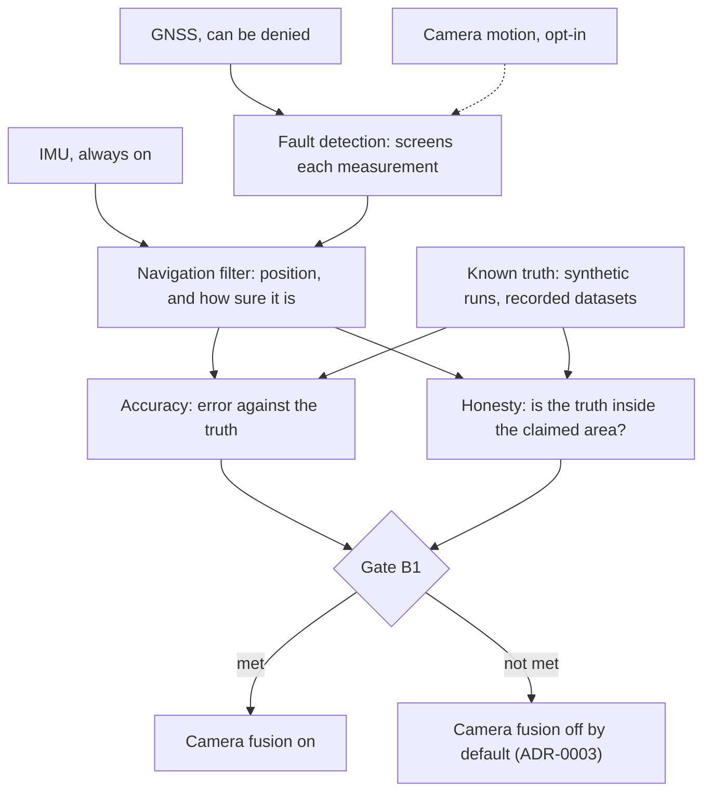

# contested-nav

**Is the filter right about how wrong it is?**

[](https://github.com/Telschow/contested-nav/actions/workflows/ci.yml)
[](https://github.com/Telschow/contested-nav/actions/workflows/security.yml)
[](https://telschow.github.io/contested-nav/)
[](LICENSE)

## In 60 seconds

**Problem.** A navigation filter has to be right about its own position and also right about how
sure it is. A drone that has lost GNSS and is steered by a filter that is wrongly confident will
trust a position it should not.

**Decision.** Should camera-based motion tracking be switched on when GNSS is denied? It makes the
position error smaller (3.768 m to 2.321 m) but the filter then claims to be within 0.162 m. It
is accurate and confidently wrong, so it **ships off by default**
([ADR-0003](docs/adr/0003-ship-visual-disabled.md)).

**Evidence.** The result held for every one of 10 noise seeds and every one of 40 outage runs, and
the numbers in the table below are regenerated and checked by CI. That table is synthetic. The filter
has also been run on recorded IMU data (EuRoC and TUM VI) with GNSS simulated from the ground truth;
see [Status and limits](docs/status.md). None of it is a field test.

**Next step.** A stochastic clone of the previous pose is built and stays opt-in
([ADR-0017](docs/adr/0017-stochastic-clone-for-the-visual-update.md)). It meets the bar for turning
vision on when the visual errors are independent. Against the measured errors of a real two-view front
end it needs the assumed noise inflated ([ADR-0023](docs/adr/0023-clone-against-a-measured-front-end.md)).
The bar is written down: a mean NEES below 10 and a 2σ coverage above 90% with GNSS denied. The
[roadmap](ROADMAP.md) calls the open problem B1.


A 21-state error-state Kalman filter and an evaluation harness for GNSS-denied navigation.
It measures not only how accurate the trajectory is, but whether the uncertainty the filter
reports is honest. With GNSS denied and visual odometry on, the filter's position error
falls from 3.768 m to 2.321 m while its claimed uncertainty collapses to 0.162 m:

| Configuration | ATE RMSE, full run | Claimed 1σ, full run | Mean NEES, full run (expected 3) | 2σ-per-axis coverage, full run (expected 99.3%) | Mean NEES, outage window (expected 3) | 2σ-per-axis coverage, outage window (expected 99.3%) |
|---|---:|---:|---:|---:|---:|---:|
| GNSS denied, vision off | 3.768 m | 0.567 m | 4.1 | 100.0% | 5.9 | 100.0% |
| GNSS denied, vision on | **2.321 m** | **0.162 m** | **286.1** | **20.5%** | **478.6** | **0.0%** |

**Accuracy improved. Calibration failed.** The filter converges and is confidently wrong, so
visual fusion ships **off by default**. Across 8 outage windows the overconfidence held in
every run; the accuracy gain did not (see [what the sweeps show](#what-the-sweeps-show)).

A stochastic clone of the previous pose (opt-in, `vision_model: clone`,
[ADR-0017](docs/adr/0017-stochastic-clone-for-the-visual-update.md)) is calibrated on the same fixture when the
visual errors are independent, and not when they are correlated over a couple of seconds; see the clone rows in the
table below. It is a synthetic result, the default is unchanged, and visual fusion still ships off.

> **Mostly synthetic evidence.** The tables on this page come from a deterministic known-answer
> fixture: an analytic trajectory with generated sensor streams. The recorded-data pages use a real
> IMU with simulated GNSS and, in one study, real camera frames. No number here is a field
> measurement.

## How it works

<!-- how-it-works-start -->


Every run is scored twice: how far the estimate is from the truth, and whether the truth falls
inside the area the filter claims. A feature that improves the first and breaks the second stays
off. A short captioned explainer is on the [project page](https://telschow.github.io/contested-nav/);
the module-level design is in [docs/architecture.md](docs/architecture.md).
<!-- how-it-works-end -->

## Quickstart

Python 3.11 to 3.13. From a fresh clone this took **18.7 s** (clone, environment, install and a
three-case run) on the machine that wrote this page:

```bash
git clone https://github.com/Telschow/contested-nav.git && cd contested-nav
python -m venv .venv && .venv/bin/pip install -e .
.venv/bin/navkit run --only gnss_only outage_control outage_visual --markdown
```

`make repro` regenerates every figure and table from scratch in about 5 minutes (321 s
measured). More in [Getting started](docs/getting-started.md).

## Results

Synthetic 30 s run, 5 Hz GNSS, 20 Hz vision, noisy IMU, seed 0. ATE uses `alignment=none`: the
filter starts in the reference frame, so there is no offset for a fitted transform to absorb.

| Scenario | ATE RMSE (m) | Claimed 1σ (m) | Mean NEES (exp. 3) | Coverage @ 2σ | Verdict |
| --- | ---: | ---: | ---: | ---: | --- |
| GNSS only (control) | 0.528 | 0.253 | 4.3 | 100.0% | mixed: bulk overconfident, tail underconfident |
| Dead reckoning (no aiding) | 2.359 | n/a | n/a | n/a | no covariance reported |
| Anchor as measurement noise (defect) | 1.063 | 0.094 | 163.7 | 16.3% | overconfident |
| Vision only | 2.320 | 0.158 | 264.2 | 0.7% | overconfident |
| GNSS denied 5–20 s, vision off (control) | 3.768 | 0.567 | 4.1 | 100.0% | mixed: bulk overconfident, tail underconfident |
| GNSS denied 5–20 s, vision on | 2.321 | 0.162 | 286.1 | 20.5% | overconfident |
| GNSS denied, 30% camera frames dropped | 2.008 | 0.192 | 203.7 | 17.8% | overconfident |
| GNSS denied 5–20 s, vision on, stochastic clone | 0.725 | 0.375 | 2.5 | 100.0% | underconfident |
| GNSS denied, 30% frames dropped, re-referenced, single anchor | 1.974 | 0.192 | 191.5 | 17.7% | overconfident |
| GNSS denied, 30% frames dropped, re-referenced, stochastic clone | 0.502 | 0.308 | 2.2 | 100.0% | underconfident |
| Vision only, stochastic clone | 1.958 | 1.326 | 2.3 | 100.0% | underconfident |
| Stochastic clone, 5% gross visual outliers | 0.727 | 0.382 | 2.5 | 100.0% | underconfident |
| Stochastic clone, drifting translation scale | 0.787 | 0.375 | 2.9 | 100.0% | underconfident |
| Stochastic clone, visual errors correlated over 2 s | 1.937 | 0.375 | 13.2 | 58.5% | overconfident |
| Stochastic clone, correlated errors, visual noise assumed 4x | 2.260 | 0.531 | 4.9 | 100.0% | mixed: bulk overconfident, tail underconfident |

This table is generated by `navkit run --markdown`, and CI fails if any cell disagrees with the
code. Interpretation, the four ATE alignments and the figures are on the
[Results page](docs/results.md).

## What the sweeps show

- **Not a bad seed.** Over 10 noise seeds, `outage_visual` is overconfident at every one: mean
  NEES 656, range 113.5 to 1589.1, coverage 6.8% to 35.2%. Over 8 synthetic trajectories all
  seven case verdicts are unchanged.
- **Not a long-outage effect.** Over 8 outage windows (start 5 s or 10 s, length 5 to 20 s, 5
  seeds each) the visual case had a 2σ coverage of 10.4% to 39.0% in all 40 runs, including 5 s
  outages. The no-vision control stayed at 98.0% to 100.0%.
- **The accuracy gain is not general.** With the outage starting at 5 s, vision beat the
  control in every seed for outages of 10 s or longer. With it starting at 10 s, vision was
  worse in all 20 runs. The cause is not tested here.

## Limits

- **Not field validated.** The benchmark is a synthetic fixture. The recorded-data studies use real
  IMU and camera data with GNSS simulated from the ground truth, and the data is not vendored.
- **Visual fusion under GNSS denial is not trustworthy.** The cause is structural (the visual
  anchor is a pose the filter itself produced) and the established remedies are not implemented
  here. See [Concepts](docs/concepts.md#the-one-thing-this-cannot-do).
- **FDIR detects implausible updates but mostly cannot say why.** A multipath signature exists as a
  function ([ADR-0022](docs/adr/0022-multipath-signature.md)). A slow-ramp spoof is followed by the
  filter with an IMU and GNSS alone ([ADR-0019](docs/adr/0019-slow-ramp-spoofing.md)), and a simulated
  visual source catches it only when it is fast and the visual errors are independent
  ([ADR-0020](docs/adr/0020-second-source-against-a-ramp.md)).
- **Not flight-ready:** no sensor driver, no live front end, no real-time loop.

All of it, with sources, is in [Status and limits](docs/status.md) and
[Limitations](docs/defense/LIMITATIONS.md).

## How this was built

The code was written mostly with an AI coding assistant (Claude Code). The maintainer sets the scope and the order of
work, and the project's rule is that the maintainer writes and accepts the decision in each ADR. The evidence to trust
is the gates, not the authorship: finite-difference checks on the measurement Jacobians, property tests, a golden
snapshot of the benchmark, and CI. Since the first week of the repository, every change lands through a pull request
that must pass CI and that the maintainer merges.

## Scope and responsible use

This is a research and evaluation library built from public sources, synthetic data and two public
recorded datasets that are fetched, never vendored. It contains no real sensor data or drivers, no
radio-frequency model (a GNSS outage is a gap in a
stream; spoofing tests inject offsets into the filter), and no guidance, targeting or platform
integration code. It is not a navigation product and is not qualified for any platform. To the
maintainer's knowledge nothing in it is classified or restricted, but that is not a legal
determination: check your own obligations before using it in a regulated or operational setting.
Details in [Scope and responsible use](docs/scope.md); report a vulnerability through the
[security policy](SECURITY.md).

## Documentation

The site is at [telschow.github.io/contested-nav](https://telschow.github.io/contested-nav/);
every page is also a Markdown file under `docs/`.

| If you want | Read |
|---|---|
| To run it | [Getting started](docs/getting-started.md) |
| The argument and the mechanism | [Concepts](docs/concepts.md), [calibration](docs/calibration.md) |
| What the filter assumes, every config key, the result format | [Model and interface contract](docs/MODEL.md) |
| Evidence on recorded data | [EuRoC](docs/euroc.md), [TUM VI](docs/tumvi.md), [where the outage error comes from](docs/attribution.md), [a real front end](docs/real_front_end.md) |
| Spoofing, multipath and fault classes | [Honest returns](docs/separability.md), [slow ramps](docs/slow_ramp.md), [classification](docs/fault_classification.md), [multipath](docs/multipath.md) |
| How fast it is, measured | [Performance](docs/PERFORMANCE.md) |
| Decisions of record | [Architecture decision records](docs/adr/index.md) |
| What is planned | [ROADMAP](ROADMAP.md), [CHANGELOG](CHANGELOG.md) |
| How to contribute | [CONTRIBUTING](CONTRIBUTING.md), [code of conduct](CODE_OF_CONDUCT.md) |

## Layout

```text
src/navkit/   estimators (ESKF, dead reckoning), fdir, sensors, degrade, eval, geometry, io
configs/      benchmark scenarios (configs/benchmark.yaml)
scripts/      thin wrappers, coverage ratchet, doc-table and link checks, secret scan
benchmarks/   timing harness for docs/PERFORMANCE.md
docs/         site pages, ADRs, figures, defense assessment, product management
tests/        unit, property, golden-snapshot and documentation consistency tests
```

## License

MIT. See [LICENSE](LICENSE).
