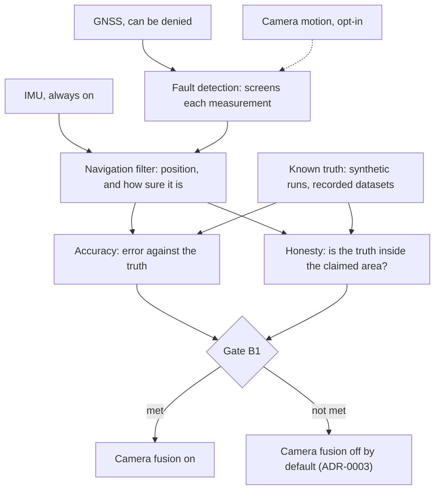

# contested-nav

**Is the filter right about how wrong it is?**

[](https://github.com/Telschow/contested-nav/actions/workflows/ci.yml)
[](https://github.com/Telschow/contested-nav/actions/workflows/security.yml)
[](https://telschow.github.io/contested-nav/)
[](LICENSE)

## In 60 seconds

**Problem.** A navigation filter has to be right about its own position and also right about how
sure it is. A drone that has lost GNSS and is steered by a filter that is wrongly confident will
trust a position it should not.

**Decision.** Should camera-based motion tracking be switched on when GNSS is denied? With the
single-anchor model it does not reliably make the position error smaller, and the filter claims to know
its position to within centimetres while the error is metres (the table below is one run with one start
draw). It is confidently wrong, so it
**ships off by default** ([ADR-0003](docs/adr/0003-ship-visual-disabled.md)).

**Evidence.** In the sweeps the overconfidence held for every one of 10 seeds and every one of 40 outage
runs (measured once on one machine, not checked by CI, at 7e33158; see [what the sweeps show](#what-the-sweeps-show)). The tables on this page
are generated by `navkit run --markdown`, and CI fails if a cell disagrees with the code. They are
synthetic. The filter has also been run on recorded IMU data (EuRoC and TUM VI) with GNSS simulated from
the ground truth; see [Status and limits](docs/status.md). None of it is a field test.

**Next step.** A stochastic clone of the previous pose is built and stays opt-in
([ADR-0017](docs/adr/0017-stochastic-clone-for-the-visual-update.md)). It meets the bar for turning
vision on when the visual errors are independent. Against the measured errors of a real two-view front
end it needs the assumed noise inflated ([ADR-0023](docs/adr/0023-clone-against-a-measured-front-end.md)).
The bar is written down: a mean NEES below 10 and a 2σ coverage above 90% with GNSS denied. The
[roadmap](ROADMAP.md) calls the open problem B1.


A 21-state error-state Kalman filter and an evaluation harness for GNSS-denied navigation.
It measures not only how accurate the trajectory is, but whether the uncertainty the filter
reports is honest. With GNSS denied and visual odometry on (the single-anchor model), the filter claims
centimetres of uncertainty while its error is metres. Every ESKF case here starts at the truth plus an error
drawn from the filter's own declared prior
([ADR-0027](docs/adr/0027-how-the-synthetic-runs-are-initialised.md)), so the table below is one run with one
start draw (seed 0). It is descriptive:

| Configuration | ATE RMSE, full run | Claimed 1σ, full run | Mean NEES, full run (expected 3) | 2σ-per-axis coverage, full run (expected 99.3%) | Mean NEES, outage window (expected 3) | 2σ-per-axis coverage, outage window (expected 99.3%) |
|---|---:|---:|---:|---:|---:|---:|
| GNSS denied, vision off | 6.530 m | 0.567 m | 3.2 | 100.0% | 4.3 | 100.0% |
| GNSS denied, vision on | **17.568 m** | **0.156 m** | **14018.6** | **19.2%** | **2783.3** | **5.0%** |

**Calibration failed, and accuracy did not improve.** The filter is confidently wrong, so
visual fusion ships **off by default**. In this single run the aided case is also less accurate than the
case without vision. Over 10 seeds, each with its own start draw, it was less accurate in 9 (measured once on one machine, not checked by CI, at e94c107), so
whether vision helps accuracy depends on the start draw, and here it mostly does not. The overconfidence held in
every run of every sweep (see [what the sweeps show](#what-the-sweeps-show)).

A stochastic clone of the previous pose (opt-in, `vision_model: clone`,
[ADR-0017](docs/adr/0017-stochastic-clone-for-the-visual-update.md)) does not reject calibration in a single run on the
same fixture when the visual errors are independent (`consistent`, or `mixed` with an underconfident bulk for the
vision-only row), and reads `overconfident` when they are correlated over a couple of seconds; see the clone rows in
the table below. A single run cannot establish calibration. The ensemble over seeds puts the independent clone rows
with a grand mean NEES below the expected value, so they are mildly conservative
([the ensemble over seeds](docs/calibration.md#the-ensemble-over-seeds)). It is a synthetic result, the default is
unchanged, and visual fusion still ships off.

> **Mostly synthetic evidence.** The tables on this page come from a deterministic known-answer
> fixture: an analytic trajectory with generated sensor streams. The recorded-data pages use a real
> IMU with simulated GNSS and, in one study, real camera frames. No number here is a field
> measurement.

## How it works

<!-- how-it-works-start -->


Every run is scored twice: how far the estimate is from the truth, and whether the truth falls
inside the area the filter claims. A feature that improves the first and breaks the second stays
off. A short captioned explainer is on the [project page](https://telschow.github.io/contested-nav/);
the module-level design is in [docs/architecture.md](docs/architecture.md).
<!-- how-it-works-end -->

## Quickstart

Python 3.11 to 3.13. From a fresh clone this took **18.7 s** (clone, environment, install and a
three-case run), measured once on one machine, not checked by CI:

```bash
git clone https://github.com/Telschow/contested-nav.git && cd contested-nav
python -m venv .venv && .venv/bin/pip install -e .
.venv/bin/navkit run --only gnss_only outage_control outage_visual --markdown
```

`make repro` regenerates every figure and table from scratch in about 5 minutes (321 s, measured
once on one machine, not checked by CI). More in [Getting started](docs/getting-started.md).

## Results

Synthetic 30 s scenario, 5 Hz GNSS, 20 Hz vision, noisy IMU, seed 0, **one start draw, so a single sample**: each ESKF
case starts at the truth plus an error drawn from its own declared prior, so this table is descriptive and not a
typical case. ATE uses `alignment=none`: no fitted transform absorbs an offset, so the start error is part of
what the table scores.

| Scenario | ATE RMSE (m) | Claimed 1σ (m) | Mean NEES (exp. 3) | Coverage @ 2σ | Verdict |
| --- | ---: | ---: | ---: | ---: | --- |
| GNSS only (control) | 0.512 | 0.254 | 4.2 | 100.0% | mixed: bulk overconfident, tail consistent |
| Dead reckoning (no aiding) | 1.248 | n/a | n/a | n/a | no covariance reported |
| Anchor as measurement noise (defect) | 11.497 | 0.100 | 13554.9 | 8.7% | overconfident† |
| Vision only | 26.727 | 0.158 | 32045.8 | 1.5% | overconfident† |
| GNSS denied 5–20 s, vision off (control) | 6.530 | 0.567 | 3.2 | 100.0% | consistent |
| GNSS denied 5–20 s, vision on | 17.568 | 0.156 | 14018.6 | 19.2% | overconfident† |
| GNSS denied, 30% camera frames dropped | 7.434 | 0.192 | 1621.3 | 22.2% | overconfident† |
| GNSS denied 5–20 s, vision on, stochastic clone | 0.730 | 0.375 | 2.2 | 100.0% | consistent |
| GNSS denied, 30% frames dropped, re-referenced, single anchor | 7.609 | 0.192 | 1698.4 | 22.7% | overconfident† |
| GNSS denied, 30% frames dropped, re-referenced, stochastic clone | 0.403 | 0.306 | 1.8 | 100.0% | mixed: bulk underconfident, tail consistent |
| Vision only, stochastic clone | 1.785 | 1.325 | 1.6 | 100.0% | consistent† |
| Stochastic clone, 5% gross visual outliers | 0.816 | 0.382 | 2.6 | 100.0% | consistent |
| Stochastic clone, drifting translation scale | 0.905 | 0.383 | 3.2 | 100.0% | consistent |
| Stochastic clone, visual errors correlated over 2 s | 3.061 | 0.395 | 30.7 | 34.1% | overconfident† |
| Stochastic clone, correlated errors, visual noise assumed 4x | 2.710 | 0.532 | 3.4 | 100.0% | consistent |

This table and the two-row table above it are generated (`navkit run --markdown` and
`python scripts/check_doc_tables.py --print-configuration-table`), and CI fails if any cell disagrees with
the benchmark. On this page, the [documentation index](docs/index.md), [Getting started](docs/getting-started.md),
the [Results page](docs/results.md) and [Status and limits](docs/status.md), CI also fails on any other
measured number in the text unless it is quoted through a metric marker that `scripts/metrics.py`
checks. Timings and figures labelled as one-off measurements are not checked. Interpretation, the four
ATE alignments and the figures are on the [Results page](docs/results.md). A dagger after a verdict means that the effective sample size behind it is truncated, so an upper bound ([ADR-0029](docs/adr/0029-how-a-single-runs-verdict-is-formed.md)). `consistent` means that the run did not reject calibration: one run cannot establish it, and a single-run verdict is descriptive.

## What the sweeps show

The seed and outage sweeps below were re-run on the start drawn from the declared prior (ADR-0027). Their outputs
are not committed, and a single run is descriptive until the ensemble statistics that will commit them are decided.
The scene sweep was last measured at 2026-10-09 on the old fixed start and was not re-run, so no scene result is
quoted. `navkit sweep seeds`, `navkit sweep outages` and `navkit sweep scenes` regenerate them.

- **Not a bad seed.** Over 10 seeds, each with its own start draw, `outage_visual` and `vision_only` were
  overconfident at every one (measured once on one machine, not checked by CI, at 7e33158).
- **Not a long-outage effect.** Over 8 outage windows (start 5 s or 10 s, length 5 to 20 s, 5 seeds each) the
  visual case was overconfident in all 40 runs, including 5 s outages (measured once on one machine, not checked by CI, at 7e33158).
- **No accuracy gain from the single anchor.** `outage_visual` had a larger ATE than `outage_control` in 9 of 10
  seeds, and in all 8 outage windows with the seeds averaged. `vision_only` was less accurate than dead reckoning
  in 10 of 10 seeds (measured once on one machine, not checked by CI, at e94c107).
- **The start attitude draw is what the anchor model fails on (MEASUREMENT).** Over 10 seeds the median ATE of
  `outage_visual` was 25.18 m with the full start draw and 4.33 m with the attitude draw switched off and the
  position and velocity draws on. For `vision_only` it was 54.15 m and 7.66 m. With only the attitude drawn, the
  medians were 27.02 m and 52.04 m. The attitude prior is 2 degrees per axis, so the anchor model does not recover
  from a start attitude error inside its own declared prior. The clone's ATE and NEES did not change in any variant
  (measured once on one machine, not checked by CI, at e94c107). Why the anchor model fails is a HYPOTHESIS and was not tested: gravity leakage from the start tilt
  error plus absolute information that the anchor model invents.
- **A control's verdict is one draw.** Over 10 seeds the `outage_control` verdict was consistent in 5,
  mixed (bulk overconfident, tail consistent) in 2 and mixed (bulk underconfident, tail consistent) in 3. The mean
  NEES of `outage_visual` spanned about two orders of magnitude over the seeds and that of `vision_only` about one,
  and the verdict of both anchor rows did not change (measured once on one machine, not checked by CI, at 7e33158).

## Limits

- **Not field validated.** The benchmark is a synthetic fixture. The recorded-data studies use real
  IMU and camera data with GNSS simulated from the ground truth, and the data is not vendored.
- **Visual fusion under GNSS denial is not trustworthy.** The cause is structural (the visual
  anchor is a pose the filter itself produced) and the established remedies are not implemented
  here. With the start drawn from the declared prior, the single-anchor model also does not recover from a start
  attitude error inside that prior (see [what the sweeps show](#what-the-sweeps-show)). See [Concepts](docs/concepts.md#the-one-thing-this-cannot-do).
- **FDIR detects implausible updates but mostly cannot say why.** A multipath signature exists as a
  function ([ADR-0022](docs/adr/0022-multipath-signature.md)). A slow-ramp spoof is followed by the
  filter with an IMU and GNSS alone ([ADR-0019](docs/adr/0019-slow-ramp-spoofing.md)), and a simulated
  visual source catches it only when it is fast and the visual errors are independent
  ([ADR-0020](docs/adr/0020-second-source-against-a-ramp.md)).
- **Not flight-ready:** no sensor driver, no live front end, no real-time loop.

All of it, with sources, is in [Status and limits](docs/status.md) and
[Limitations](docs/defense/LIMITATIONS.md).

## How this was built

The code was written mostly with an AI coding assistant (Claude Code). The maintainer sets the scope and the order of
work, and the project's rule is that the maintainer writes and accepts the decision in each ADR. The evidence to trust
is the gates, not the authorship: finite-difference checks on the measurement Jacobians, property tests, a golden
snapshot of the benchmark, and CI. Since the first week of the repository, every change lands through a pull request
that must pass CI and that the maintainer merges.

## Scope and responsible use

This is a research and evaluation library built from public sources, synthetic data and two public
recorded datasets that are fetched, never vendored. It contains no real sensor data or drivers, no
radio-frequency model (a GNSS outage is a gap in a
stream; spoofing tests inject offsets into the filter), and no guidance, targeting or platform
integration code. It is not a navigation product and is not qualified for any platform. To the
maintainer's knowledge nothing in it is classified or restricted, but that is not a legal
determination: check your own obligations before using it in a regulated or operational setting.
Details in [Scope and responsible use](docs/scope.md); report a vulnerability through the
[security policy](SECURITY.md).

## Documentation

The site is at [telschow.github.io/contested-nav](https://telschow.github.io/contested-nav/);
every page is also a Markdown file under `docs/`.

| If you want | Read |
|---|---|
| To run it | [Getting started](docs/getting-started.md) |
| The argument and the mechanism | [Concepts](docs/concepts.md), [calibration](docs/calibration.md) |
| What the filter assumes, every config key, the result format | [Model and interface contract](docs/MODEL.md) |
| Evidence on recorded data | [EuRoC](docs/euroc.md), [TUM VI](docs/tumvi.md), [UrbanNav (real GNSS outage)](docs/urbannav.md), [where the outage error comes from](docs/attribution.md), [a real front end](docs/real_front_end.md) |
| Spoofing, multipath and fault classes | [Honest returns](docs/separability.md), [slow ramps](docs/slow_ramp.md), [classification](docs/fault_classification.md), [multipath](docs/multipath.md) |
| How fast it is, measured | [Performance](docs/PERFORMANCE.md) |
| Decisions of record | [Architecture decision records](docs/adr/index.md) |
| What is planned | [ROADMAP](ROADMAP.md), [CHANGELOG](CHANGELOG.md) |
| How to contribute | [CONTRIBUTING](CONTRIBUTING.md), [code of conduct](CODE_OF_CONDUCT.md) |

## Layout

```text
src/navkit/   estimators (ESKF, dead reckoning), fdir, sensors, degrade, eval, geometry, io
configs/      benchmark scenarios (configs/benchmark.yaml)
scripts/      thin wrappers, coverage ratchet, doc-table and link checks, secret scan
benchmarks/   timing harness for docs/PERFORMANCE.md
docs/         site pages, ADRs, figures, defense assessment, product management
tests/        unit, property, golden-snapshot and documentation consistency tests
```

## Acknowledgements

The recorded GNSS and IMU data on the [UrbanNav page](docs/urbannav.md) is from the UrbanNav dataset
([github.com/IPNL-POLYU/UrbanNavDataset](https://github.com/IPNL-POLYU/UrbanNavDataset)). The authors ask for a
citation of Hsu et al. (2023), NAVIGATION. UrbanNav: an open-sourced multisensory dataset for urban positioning.
The authors state that the dataset files are MIT licensed. The data is fetched with `navkit urbannav fetch` and is
not part of this repository. Only aggregate results are published here.

## License

MIT. See [LICENSE](LICENSE).
