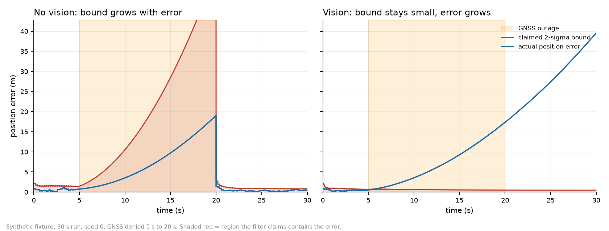

# contested-nav

**Is the filter right about how wrong it is?**

<video controls preload="metadata" poster="assets/video/explainer-poster.jpg" style="width:100%">
  <source src="assets/video/contested-nav-explainer.mp4" type="video/mp4">
</video>

*A captioned explainer built from one benchmark run: the same GNSS outage with the camera off and
on, the measured accuracy and calibration, and the decision that follows.*

`contested-nav` is a 21-state error-state Kalman filter and an evaluation harness for GNSS-denied
navigation. It measures not only how accurate the trajectory is, but whether the uncertainty the
filter reports is honest.

| Configuration | ATE RMSE, full run | Claimed 1σ, full run | Mean NEES, full run (expected 3) | 2σ-per-axis coverage, full run (expected 99.3%) | Mean NEES, outage window (expected 3) | 2σ-per-axis coverage, outage window (expected 99.3%) |
|---|---:|---:|---:|---:|---:|---:|
| GNSS denied, vision off | 3.768 m | 0.567 m | 4.1 | 100.0% | 5.9 | 100.0% |
| GNSS denied, vision on | **2.321 m** | **0.162 m** | **286.1** | **20.5%** | **478.6** | **0.0%** |

**Accuracy improved. Calibration failed.** The filter converges and is confidently wrong, so visual
fusion ships off by default. The overconfidence held in every run of every sweep; the accuracy gain
did not (see [Results](results.md)).

!!! warning "Mostly synthetic evidence"
    The table above comes from a deterministic known-answer fixture. The recorded-data pages use a
    real IMU with GNSS simulated from the ground truth. No number here is a field measurement.

## How it works



## Where to start

- [Getting started](getting-started.md): install, run the headline case in 19 seconds (measured once on one machine, not checked by CI), reproduce every number.
- [Concepts](concepts.md): why this is not a tuning problem, what is in the filter, how calibration is measured.
- [Results](results.md): the benchmark scenarios, the sweeps and what they do and do not show.
- On recorded data: [EuRoC](euroc.md), [TUM VI](tumvi.md), [where the outage error comes from](attribution.md) and
  [a real front end](real_front_end.md).
- On spoofing and fault classes: [honest returns](separability.md), [slow ramps](slow_ramp.md),
  [classification](fault_classification.md) and [multipath](multipath.md).
- [Model and interface contract](MODEL.md): units, frames, every configuration key, the result format and a fault-mode table.
- [Scope and responsible use](scope.md) and [Status and limits](status.md).
