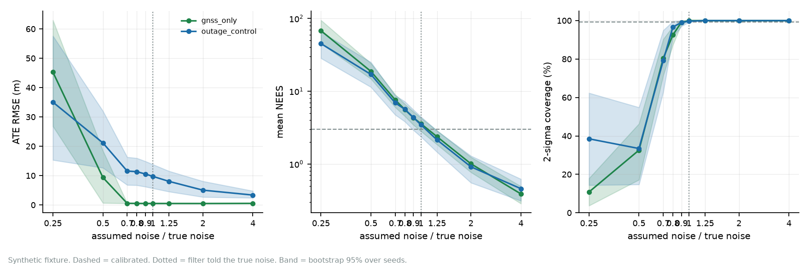

# Noise mismatch

What happens when the filter is told the wrong sensor noise.

Every calibrated result elsewhere in this site has the filter told the true noise of the
sensors that made the data. That is the easiest case a Kalman filter can have, and a real
filter never gets it. This page generates the data once with the true noise and filters it
with the assumed GNSS and vision sigmas multiplied by a factor. A factor below 1 makes the
filter trust the sensor more than it should; above 1, less. ([Model contract](MODEL.md),
as-implemented finding 5.)

```bash
navkit sweep mismatch --csv docs/data/mismatch_sweep.csv \
    --figure docs/figures/mismatch-sweep.png --page docs/mismatch.md
```

Two cases, nine factors, five noise seeds each. `gnss_only` has GNSS and no outage;
`outage_control` has the 15 s GNSS outage with vision off. The table below is generated from
[`data/mismatch_sweep.csv`](data/mismatch_sweep.csv) and a test fails if they disagree. CI
reruns the sweep and fails if the committed CSV no longer matches it.

<!-- mismatch:start -->

| Case | Assumed noise x | ATE rmse m [95% CI] | NEES mean [95% CI] | Coverage @2σ % [95% CI] | Claimed 1σ m | GNSS fixes rejected % [95% CI] | Verdicts | Runs with truncated n_eff |
|---|---:|---|---|---|---:|---|---|---:|
| gnss_only | 0.25 | 48.81 [22.30, 75.32] | 53.6 [35.7, 71.4] | 7.7 [3.6, 14.0] | 8.369 | 94.6 [92.2, 96.4] | overconfident x5 | 3 of 5 |
| gnss_only | 0.5 | 17.05 [0.68, 33.59] | 29.1 [15.1, 50.3] | 31.8 [14.7, 48.8] | 2.470 | 47.7 [21.2, 75.6] | overconfident x5 | 1 of 5 |
| gnss_only | 0.7 | 0.59 [0.55, 0.62] | 7.6 [6.2, 8.9] | 80.4 [72.8, 88.5] | 0.189 | 4.8 [3.8, 5.6] | overconfident x5 | 0 of 5 |
| gnss_only | 0.8 | 0.55 [0.50, 0.59] | 5.5 [4.8, 6.2] | 94.2 [92.6, 95.7] | 0.207 | 0.9 [0.4, 1.3] | mixed(bulk=overconfident, tail=consistent) x1, overconfident x4 | 0 of 5 |
| gnss_only | 0.9 | 0.53 [0.49, 0.58] | 4.4 [3.7, 5.1] | 98.7 [97.7, 99.7] | 0.229 | 0.1 [0.0, 0.4] | consistent x2, mixed(bulk=overconfident, tail=consistent) x3 | 0 of 5 |
| gnss_only | 1 | 0.53 [0.49, 0.58] | 3.7 [3.1, 4.2] | 99.9 [99.6, 100.0] | 0.253 | 0.0 [0.0, 0.0] | consistent x3, mixed(bulk=overconfident, tail=consistent) x2 | 0 of 5 |
| gnss_only | 1.25 | 0.54 [0.49, 0.58] | 2.5 [2.1, 2.9] | 100.0 [100.0, 100.0] | 0.313 | 0.0 [0.0, 0.0] | consistent x3, mixed(bulk=underconfident, tail=consistent) x2 | 1 of 5 |
| gnss_only | 2 | 0.56 [0.52, 0.61] | 1.2 [1.0, 1.4] | 100.0 [100.0, 100.0] | 0.489 | 0.0 [0.0, 0.0] | consistent x1, mixed(bulk=underconfident, tail=consistent) x4 | 1 of 5 |
| gnss_only | 4 | 0.72 [0.65, 0.79] | 0.6 [0.5, 0.6] | 100.0 [100.0, 100.0] | 0.921 | 0.0 [0.0, 0.0] | mixed(bulk=underconfident, tail=consistent) x5 | 2 of 5 |
| outage_control | 0.25 | 67.15 [39.13, 92.84] | 38.2 [22.8, 61.8] | 10.5 [3.5, 22.7] | 11.682 | 90.8 [86.8, 94.5] | overconfident x5 | 2 of 5 |
| outage_control | 0.5 | 18.36 [10.65, 29.97] | 17.8 [13.0, 25.4] | 35.2 [17.8, 51.9] | 2.369 | 35.0 [18.7, 59.2] | overconfident x5 | 0 of 5 |
| outage_control | 0.7 | 12.74 [9.08, 16.02] | 7.1 [5.4, 8.6] | 84.5 [67.6, 95.7] | 0.432 | 3.9 [3.2, 4.7] | consistent x1, overconfident x4 | 0 of 5 |
| outage_control | 0.8 | 11.76 [8.66, 14.85] | 5.6 [4.2, 7.0] | 95.4 [88.6, 99.6] | 0.464 | 0.8 [0.0, 1.8] | consistent x1, mixed(bulk=overconfident, tail=consistent) x2, overconfident x2 | 0 of 5 |
| outage_control | 0.9 | 11.55 [8.72, 14.23] | 4.5 [3.3, 5.6] | 98.9 [97.6, 100.0] | 0.512 | 0.0 [0.0, 0.0] | consistent x2, mixed(bulk=overconfident, tail=consistent) x3 | 0 of 5 |
| outage_control | 1 | 10.88 [8.47, 13.34] | 3.6 [2.8, 4.5] | 99.7 [99.5, 100.0] | 0.567 | 0.0 [0.0, 0.0] | consistent x4, mixed(bulk=overconfident, tail=consistent) x1 | 0 of 5 |
| outage_control | 1.25 | 9.51 [7.11, 11.90] | 2.4 [1.9, 3.0] | 100.0 [100.0, 100.0] | 0.703 | 0.0 [0.0, 0.0] | consistent x4, mixed(bulk=underconfident, tail=consistent) x1 | 0 of 5 |
| outage_control | 2 | 8.15 [5.56, 10.70] | 1.2 [0.9, 1.5] | 100.0 [100.0, 100.0] | 0.944 | 0.0 [0.0, 0.0] | mixed(bulk=underconfident, tail=consistent) x5 | 0 of 5 |
| outage_control | 4 | 10.21 [7.21, 13.65] | 0.9 [0.5, 1.3] | 100.0 [100.0, 100.0] | 1.713 | 0.0 [0.0, 0.0] | mixed(bulk=underconfident, tail=consistent) x5 | 1 of 5 |

<!-- mismatch:end -->



## What it shows

Each statement below is checked against the CSV by `tests/test_mismatch_sweep.py`.

1. **An optimistic noise model is not a graceful failure.** With the assumed noise below the
   true noise, the chi-square gate starts rejecting healthy GNSS fixes (see the rejection
   column), the filter dead-reckons through the gap, and error grows. In `gnss_only` it grows by
   more than an order of magnitude at the strongest mismatch; in `outage_control`, which starts
   from a large error, it still more than doubles. The gate meant to protect the filter from bad data turns an
   optimistic noise model into data loss. The rejection column shows it directly.
2. **Calibration is lost well before the gate does much damage.** Mean 2σ coverage leaves a
   90% band between factors 0.7 and 0.8 in both cases, while the rejection share is still in
   single digits. An underestimate of the sensor noise of between 20% and 30% is enough. The
   90% band is my choice, not a derived threshold.
3. **A pessimistic noise model costs little accuracy and is honest about it.** With the assumed
   noise above the true noise, the position error in `gnss_only` barely moves at a factor of two and rises
   modestly at four, the claimed uncertainty scales up with the assumption and coverage stays at 100%. At factors of
   two and four the bulk test of one run reads underconfident in at least four of the five seeds, in both cases.
   Looser, not wrong.
4. **With the true noise, one run's bulk test is not a clean read.** At factor 1 the mean NEES is above 3 in both
   cases. Its interval includes 3 in `outage_control` and only just excludes it in `gnss_only`. The bulk test of a
   single run reads consistent in three of the five `gnss_only` seeds and four of the five `outage_control` seeds, and
   rejects calibration, as overconfident, in two `gnss_only` seeds and one `outage_control` seed. By factor 1.25 the mean NEES is below 3.
5. **One result I did not expect and have not explained.** In `outage_control`, position error
   falls as the assumed noise grows from the strongest mismatch up to a factor of two, and the intervals at those
   two ends do not overlap. At four it is no better than at two. Between the true noise and a factor of two the
   intervals overlap, so five seeds do not establish a trend near the true noise. An earlier version of this page
   saw the error fall all the way to four, with non-overlapping intervals at one and four; that did not survive the
   start being drawn from the declared prior. A plausible reason for the fall is that a larger assumed noise keeps
   the bias states from fitting GNSS noise before the outage, which would make dead reckoning through it better.
   That is a hypothesis; I did not test it.
6. **One run cannot resolve a mild mismatch.** At a factor of 1.25 the bulk test of one run reads consistent in three
   of the five `gnss_only` seeds and four of the five `outage_control` seeds, and in no seed does it read
   overconfident. That is the same word it gives at the true noise. Only a large mismatch gets a clear verdict from one
   run: every seed reads overconfident at factors 0.25 and 0.5, and the bulk test reads underconfident in at least four
   of five seeds at factors 2 and 4. A filter told 20% too little noise (factor 0.8) is still flagged overconfident in
   at least four of five seeds, so the loss of resolution is on the pessimistic side. A single run is worth far fewer
   independent samples than it has epochs ([the effective sample size per case](calibration.md#how-many-independent-samples-a-run-is-worth)),
   so its verdict is descriptive. The ensemble over seeds
   ([how it is defined](calibration.md#the-ensemble-over-seeds)) is tried on the same cells in the next section. It
   resolves some mild mismatches that one run does not, and it does not resolve all of them.

## The ensemble over seeds

One run cannot resolve a mild mismatch (statement 6). This section runs every cell as an ensemble instead, the way
[the calibration page](calibration.md#the-ensemble-over-seeds) does for the benchmark cases. Each cell is run for 25
seeds, the NEES is averaged over the runs at each epoch, and that mean is compared with the chi-square band for 25 runs
and 3 degrees of freedom. The seeds are 25 to 49, the development seeds of
[ADR-0030](adr/0030-the-gate-for-the-next-visual-update-candidate.md). The single-run table above uses seeds 0 to 4, so
the two tables share no draw. `outage_control` also has an `outage` scope, which scores only the epochs inside the GNSS
outage.

```bash
navkit sweep mismatch --ensemble-csv docs/data/mismatch_ensemble.csv --ensemble-page docs/mismatch.md
```

The table and the sentences below are generated from [`data/mismatch_ensemble.csv`](data/mismatch_ensemble.csv) and the
single-run CSV. A test rebuilds them from those files and fails if the page differs.

<!-- mismatch-ensemble:start -->

Band for the ensemble mean over N = 25 runs with 3 degrees of freedom: 2.118 to 4.034. Shares are of the scored epochs.

| Case | Assumed noise x | Scope | Scored epochs | Grand mean NEES | Inside the band | Below | Above |
|---|---:|---|---:|---:|---:|---:|---:|
| gnss_only | 0.25 | full | 6001 | 44.56 | 0.0% | 0.0% | 100.0% |
| gnss_only | 0.5 | full | 6001 | 20.57 | 0.0% | 0.0% | 100.0% |
| gnss_only | 0.7 | full | 6001 | 6.11 | 4.4% | 0.0% | 95.6% |
| gnss_only | 0.8 | full | 6001 | 4.592 | 21.7% | 0.0% | 78.3% |
| gnss_only | 0.9 | full | 6001 | 3.523 | 87.0% | 0.1% | 12.8% |
| gnss_only | 1 | full | 6001 | 2.888 | 94.9% | 4.7% | 0.4% |
| gnss_only | 1.25 | full | 6001 | 1.961 | 26.5% | 73.5% | 0.0% |
| gnss_only | 2 | full | 6001 | 0.995 | 2.6% | 97.4% | 0.0% |
| gnss_only | 4 | full | 6001 | 0.6246 | 4.0% | 96.0% | 0.0% |
| outage_control | 0.25 | full | 6001 | 36.79 | 0.0% | 0.0% | 100.0% |
| outage_control | 0.25 | outage | 3000 | 30.62 | 0.0% | 0.0% | 100.0% |
| outage_control | 0.5 | full | 6001 | 13.1 | 0.0% | 0.0% | 100.0% |
| outage_control | 0.5 | outage | 3000 | 10.48 | 0.0% | 0.0% | 100.0% |
| outage_control | 0.7 | full | 6001 | 4.514 | 51.5% | 0.0% | 48.5% |
| outage_control | 0.7 | outage | 3000 | 3.596 | 99.1% | 0.0% | 0.9% |
| outage_control | 0.8 | full | 6001 | 3.218 | 71.8% | 0.0% | 28.2% |
| outage_control | 0.8 | outage | 3000 | 2.396 | 100.0% | 0.0% | 0.0% |
| outage_control | 0.9 | full | 6001 | 2.557 | 50.3% | 48.3% | 1.4% |
| outage_control | 0.9 | outage | 3000 | 1.933 | 3.7% | 96.3% | 0.0% |
| outage_control | 1 | full | 6001 | 2.147 | 45.0% | 54.7% | 0.4% |
| outage_control | 1 | outage | 3000 | 1.649 | 0.0% | 100.0% | 0.0% |
| outage_control | 1.25 | full | 6001 | 1.573 | 5.3% | 94.7% | 0.0% |
| outage_control | 1.25 | outage | 3000 | 1.322 | 0.0% | 100.0% | 0.0% |
| outage_control | 2 | full | 6001 | 1.114 | 2.5% | 97.5% | 0.0% |
| outage_control | 2 | outage | 3000 | 1.234 | 0.0% | 100.0% | 0.0% |
| outage_control | 4 | full | 6001 | 1.103 | 4.0% | 96.0% | 0.0% |
| outage_control | 4 | outage | 3000 | 1.469 | 0.0% | 100.0% | 0.0% |

My rule for resolved, which is a choice and not a test: the mild factors are 0.8, 0.9 and 1.25. The ensemble resolves one when its mean is outside the band, on the side the mismatch predicts, for more than 50.0% of the scored epochs and for a larger share than at the true noise. One run resolves it when its bulk test reads the predicted way in at least 4 of 5 seeds.

- gnss_only: with the assumed noise below the true noise, the ensemble mean is above the band for 100.0%, 100.0%, 95.6%, 78.3% and 12.8% of the scored epochs at factors 0.25, 0.5, 0.7, 0.8 and 0.9, a share that rises or stays level as the mismatch grows.
- gnss_only: with the assumed noise above the true noise, the ensemble mean is below the band for 73.5%, 97.4% and 96.0% of the scored epochs at factors 1.25, 2 and 4, a share that does not keep rising as the mismatch grows.
- gnss_only: at the true noise (factor 1) the ensemble mean is inside the band for 94.9% of the scored epochs, below it for 4.7% and above it for 0.4%.
- gnss_only: of the mild factors 0.8, 0.9 and 1.25, the ensemble resolves 0.8 and 1.25 and not 0.9.
- outage_control: with the assumed noise below the true noise, the ensemble mean is above the band for 100.0%, 100.0%, 48.5%, 28.2% and 1.4% of the scored epochs at factors 0.25, 0.5, 0.7, 0.8 and 0.9, a share that rises or stays level as the mismatch grows.
- outage_control: with the assumed noise above the true noise, the ensemble mean is below the band for 94.7%, 97.5% and 96.0% of the scored epochs at factors 1.25, 2 and 4, a share that does not keep rising as the mismatch grows.
- outage_control: at the true noise (factor 1) the ensemble mean is inside the band for 45.0% of the scored epochs, below it for 54.7% and above it for 0.4%. That is not inside the band for most epochs, so for this case read the factors against each other, not against the band.
- outage_control: of the mild factors 0.8, 0.9 and 1.25, the ensemble resolves 1.25 and not 0.8 and 0.9.
- outage_control (outage scope): with the assumed noise below the true noise, the ensemble mean is above the band for 100.0%, 100.0%, 0.9%, 0.0% and 0.0% of the scored epochs at factors 0.25, 0.5, 0.7, 0.8 and 0.9, a share that rises or stays level as the mismatch grows.
- outage_control (outage scope): with the assumed noise above the true noise, the ensemble mean is below the band for 100.0%, 100.0% and 100.0% of the scored epochs at factors 1.25, 2 and 4, a share that is level.
- outage_control (outage scope): at the true noise (factor 1) the ensemble mean is inside the band for 0.0% of the scored epochs, below it for 100.0% and above it for 0.0%. That is not inside the band for most epochs, so for this case read the factors against each other, not against the band.
- outage_control (outage scope): of the mild factors 0.8, 0.9 and 1.25, the ensemble resolves none of them.
- Against the single-run table, gnss_only, mild factors: both resolve 0.8; only the ensemble resolves 1.25; neither resolves 0.9.
- Against the single-run table, outage_control, mild factors: only the ensemble resolves 1.25; only one run resolves 0.8; neither resolves 0.9.
- The ensemble resolves some mild mismatch that one run does not: gnss_only at 1.25; outage_control at 1.25.
- One run resolves some mild mismatch that the ensemble does not: outage_control at 0.8.
- The ensemble does not resolve every mild mismatch: gnss_only at 0.9; outage_control at 0.8 and 0.9; outage_control (outage scope) at 0.8, 0.9 and 1.25.

<!-- mismatch-ensemble:end -->

How to read it:

- The shares are descriptive, not a p-value. Epochs within a run are strongly autocorrelated, so the scored epochs are
  far from independent ([the effective sample size](calibration.md#how-many-independent-samples-a-run-is-worth)).
- The true noise is not a fixed point of this table. In `outage_control` the outage scope at factor 1 is below the band
  on these seeds, and on seeds 0 to 24 the benchmark ensemble has the same scope inside the band
  ([the benchmark ensemble](calibration.md#the-ensemble-over-seeds)). The result depends on the seeds, and I have not
  explained why. Read the factors against the factor 1 row, not against the band alone.
- A row inside the band describes one ensemble of 25 runs. It is not a verdict on the filter.

## What this does not show

- One synthetic path, one noise model (white and Gaussian), and one factor applied to every
  axis and, with `--channel both`, to both sensors. Nothing here says how a real receiver's
  noise is mismatched.
- Only the assumed GNSS and vision sigmas change. IMU noise, the outage window and the
  trajectory do not.
- Both cases have the default IMU noise ([ADR-0012](adr/0012-every-scenario-is-injected.md)). An
  earlier version of this sweep ran `gnss_only` with a noiseless IMU; it was rerun after that was fixed
  and the statements above still hold.
- Five seeds per cell, so the intervals are rough. At factor 1 the per-seed verdicts are split
  between `consistent` and `mixed`; the verdict column shows the split rather than a single label. The last column
  counts the runs whose effective sample size is truncated, so an upper bound (ADR-0029); the verdict counts are not
  split by it.
- It does not say what the right noise is, or how to estimate it. Adaptive noise estimation is
  not implemented.
