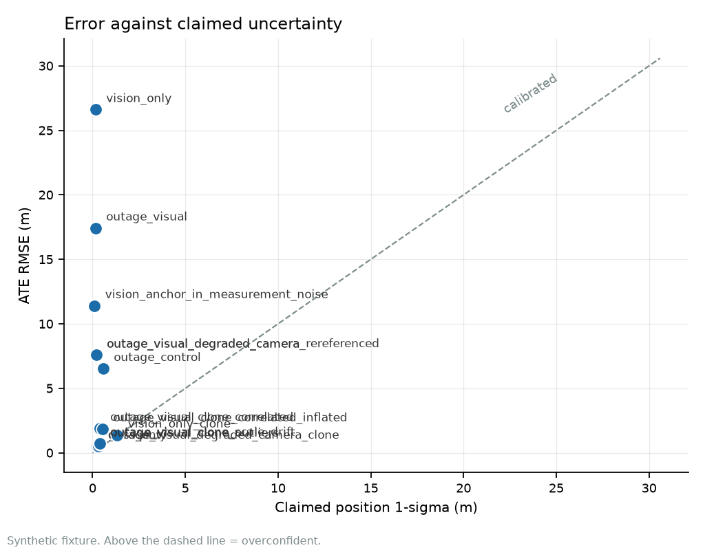
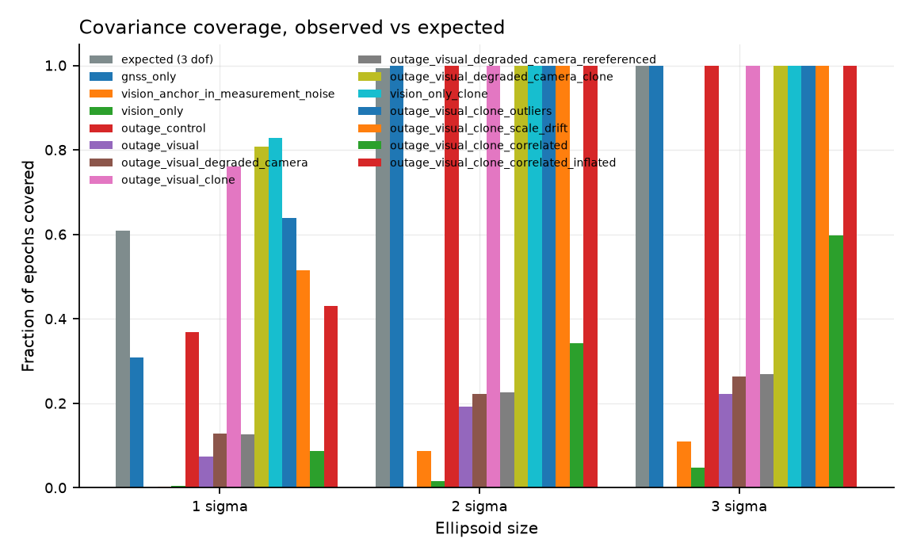
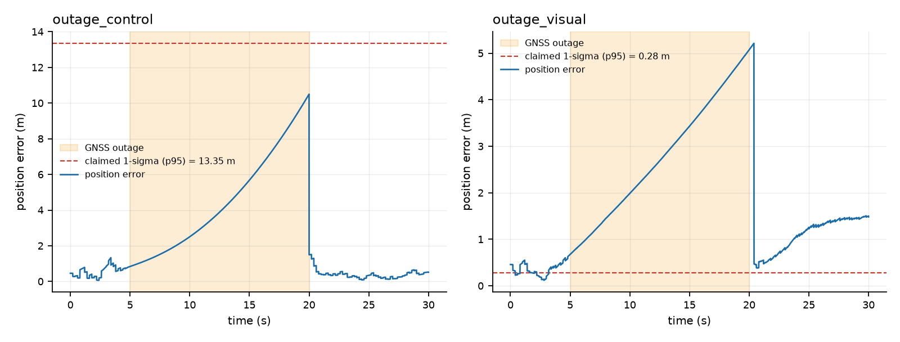
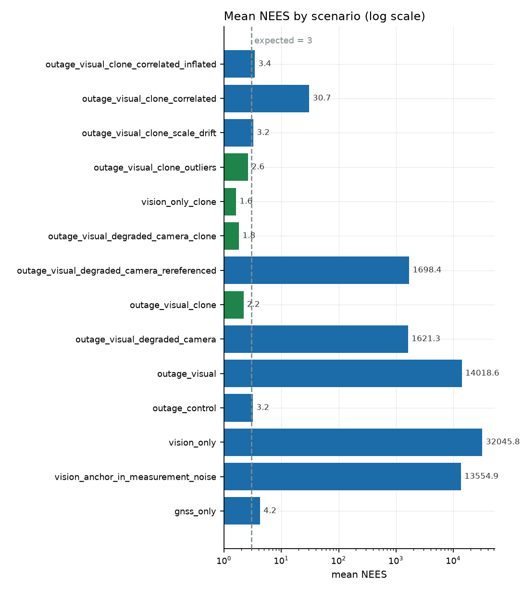

# Results

Synthetic 30 s run, 5 Hz GNSS, 20 Hz vision, noisy IMU, 21-state ESKF. ATE is
reported with `alignment=none`: no fitted transform absorbs an offset, so the start error is part of
what is measured. This is the strictest of the four conventions the code supports. Every ESKF case starts at the
true initial state plus an error drawn from the filter's own declared prior
([ADR-0027](adr/0027-how-the-synthetic-runs-are-initialised.md)), from a stream seeded by the case seed.
**The table is a single run with one start draw (seed 0), and is descriptive:** other draws give other numbers, and
some control verdicts change with the draw (see below).

| Scenario | ATE RMSE (m) | Claimed 1σ (m) | Mean NEES (exp. 3) | Coverage @ 2σ | Verdict |
| --- | ---: | ---: | ---: | ---: | --- |
| GNSS only (control) | 0.512 | 0.254 | 4.2 | 100.0% | mixed: bulk overconfident, tail consistent |
| Dead reckoning (no aiding) | 1.248 | n/a | n/a | n/a | no covariance reported |
| Anchor as measurement noise (defect) | 11.497 | 0.100 | 13554.9 | 8.7% | overconfident† |
| Vision only | 26.727 | 0.158 | 32045.8 | 1.5% | overconfident† |
| GNSS denied 5–20 s, vision off (control) | 6.530 | 0.567 | 3.2 | 100.0% | consistent |
| GNSS denied 5–20 s, vision on | 17.568 | 0.156 | 14018.6 | 19.2% | overconfident† |
| GNSS denied, 30% camera frames dropped | 7.434 | 0.192 | 1621.3 | 22.2% | overconfident† |
| GNSS denied 5–20 s, vision on, stochastic clone | 0.730 | 0.375 | 2.2 | 100.0% | consistent |
| GNSS denied, 30% frames dropped, re-referenced, single anchor | 7.609 | 0.192 | 1698.4 | 22.7% | overconfident† |
| GNSS denied, 30% frames dropped, re-referenced, stochastic clone | 0.403 | 0.306 | 1.8 | 100.0% | mixed: bulk underconfident, tail consistent |
| Vision only, stochastic clone | 1.785 | 1.325 | 1.6 | 100.0% | consistent† |
| Stochastic clone, 5% gross visual outliers | 0.816 | 0.382 | 2.6 | 100.0% | consistent |
| Stochastic clone, drifting translation scale | 0.905 | 0.383 | 3.2 | 100.0% | consistent |
| Stochastic clone, visual errors correlated over 2 s | 3.061 | 0.395 | 30.7 | 34.1% | overconfident† |
| Stochastic clone, correlated errors, visual noise assumed 4x | 2.710 | 0.532 | 3.4 | 100.0% | consistent |

Three things deserve more than a glance.

**The defect row is not a gate-threshold problem.** Folding the visual anchor
error into the measurement covariance, rather than treating it as filter state,
drops coverage far below its expected value (the `vision_anchor_in_measurement_noise` row). Both variants
are in the benchmark so the comparison is
reproducible, and the broken one is kept in the default run on purpose.

**Turning vision on makes the claimed uncertainty far too small, and with the single anchor it does not make
the filter more accurate.** In this single run with one start draw, the outage control with vision off has the smaller ATE RMSE of
the two, and its uncertainty grew to match, so its coverage stays at the expected level. The aided case claims
centimetres of uncertainty while being metres wrong. Over 10 seeds the aided case had the larger ATE in 9 (measured once on one machine, not checked by CI, at 946d661),
so which filter is more accurate depends on the start draw, and on this fixture it is mostly the one without vision.
That is a change from the earlier fixed start, which had a position offset and no attitude error: there the
FDIR gate had first made the aided case worse on ATE, then the fix for that (R2 in
[CONSTRAINTS.md](https://github.com/Telschow/contested-nav/blob/main/CONSTRAINTS.md), which describes the state at
the time) put it ahead, and the ATE column stopped flagging it. With the start drawn from the prior, the ATE and
calibration columns point the same way for the anchor model. Ranking by error is still not a calibration check.

**The anchor model does not recover from a start attitude error inside its own prior (MEASUREMENT).** Over 10 seeds
the median ATE of `outage_visual` was several times larger with the full start draw than with the attitude draw
switched off, and the same held for `vision_only`. With only the attitude drawn the medians were close to those of the
full draw. The clone's results did not change in any variant (measured once on one machine, not checked by CI, at e94c107). Produced under the earlier draw of the synthetic visual translation noise (ADR-0033); not regenerated (being re-measured as a generated table: issue #168). The mechanism is a HYPOTHESIS and was not tested:
gravity leakage from the start tilt error plus absolute information that the anchor model invents.

**One run is one draw.** Over 10 seeds the verdict of the `outage_control` row was consistent in 5, mixed
(bulk overconfident, tail consistent) in 2 and mixed (bulk underconfident, tail consistent) in 3. The mean NEES of
`outage_visual` spanned about two orders of magnitude over the seeds and that of `vision_only` about one, while the
verdict of both anchor rows stayed overconfident (measured once on one machine, not checked by CI, at 946d661). Read a control row's verdict above as one draw. The
test of consistency is the ensemble over seeds ([the ensemble over seeds](calibration.md#the-ensemble-over-seeds)).
A dagger after a verdict means that the effective sample size behind it is truncated, so an upper bound ([ADR-0029](adr/0029-how-a-single-runs-verdict-is-formed.md)). `consistent` means that the run did not reject calibration: one run cannot establish it, and a single-run verdict is descriptive.

**Relative visual poses must not make the filter more certain about where it is.** Global position cannot be
observed from relative pose, so a filter with no absolute sensor must not claim a smaller position uncertainty than
its starting prior. [A test](https://github.com/Telschow/contested-nav/blob/main/tests/test_observability.py)
checks this on the vision-only rows: the stochastic clone keeps the property, the single-anchor control breaks it
and is pinned as the defect, and a GNSS-aided run shrinks below the prior, which is correct for an absolute sensor.

**Dead reckoning has no claimed-σ or NEES value.** An integrator with no
uncertainty model has nothing to calibrate. Printing a covariance it never
computed would be the same error as printing one it does not deserve, so the
columns are `n/a` rather than zero.

### Two verdicts, not one

Calibration is reported as a **bulk** test (mean NEES against its expectation)
and a **tail** test (coverage inside the 2σ ellipsoid, by Wilson interval), and
a disagreement is named rather than resolved. A filter can be marginally
overconfident almost everywhere while never once producing a tail escape;
collapsing that into a single "consistent" boolean discards half the evidence
and hides the shape of the error distribution.

A `mixed` row is a disagreement of that kind: in the bulk the mean NEES is outside the band built on the run's
effective sample size, while the tail test does not reject. Both statements are true and only one of them is usually
quoted.

### What one run's verdict means

A verdict is formed with the effective sample size of the run's scored NEES series, not with its epoch count, because
the epochs of a run are strongly autocorrelated
([ADR-0029](adr/0029-how-a-single-runs-verdict-is-formed.md);
[the effective sample size per case](calibration.md#how-many-independent-samples-a-run-is-worth)). The bands are
wider than a count of epochs would give, so a single run rejects calibration less often than it used to. The
words changed with the rule: `consistent` replaces `calibrated`, and it means that the run did not reject
calibration. One run cannot establish calibration. The decision tools are the ensemble over seeds and the gate of
[ADR-0028](adr/0028-the-b1-gate.md).

- **The clone rows.** The clone rows with independent visual errors read `consistent` in a single run, except the
  re-referenced degraded-camera clone, which reads `mixed` with an underconfident bulk, and the vision-only clone,
  whose `consistent` carries a dagger. A `consistent` reading does not establish calibration. The ensemble table
  puts none of these rows below the band, and the row with a drifting translation scale has a large share above it
  ([the ensemble over seeds](calibration.md#the-ensemble-over-seeds)).
- **The `gnss_only` row.** It reads `mixed` here: on this seed the bulk test rejects calibration and the tail test
  does not. That is one run and it is descriptive. The ensemble puts the same case inside its band for most scored
  epochs.
- **The single-anchor rows carry a dagger.** Their effective sample size is truncated, so it is an upper bound and the
  band is narrower than it should be, because the estimated autocorrelation time is a lower bound. For a borderline
  case that could produce a false overconfident call. It does not matter for these rows: their mean NEES is orders of
  magnitude above any band.

### Alignment is not a detail

ATE is reported four ways, because the convention changes the number by metres
and an ATE quoted without its alignment is not a result:

| Alignment | Fitted on | What it hides |
| --- | --- | --- |
| `none` | nothing | nothing; the raw error in the filter's own frame |
| `rigid` | all poses | accumulated drift, absorbed into the fit |
| `rigid_start` | first 20% only | nothing after the first fifth of the run |
| `similarity` | all poses, with scale | a scale error in the estimate |

All headline numbers above use `none`. A rigid fit uses positions only, so
attitude error passes through it untouched and is reported separately; a reader
who assumed "rigid alignment" meant 6-DoF pose alignment would otherwise quote
an attitude error several times smaller than reality.

**A stochastic clone of the previous pose removes the overconfidence on this fixture.** The rows ending in
"stochastic clone" run the same scenarios with the previous visual pose carried as six error states that start
perfectly correlated with the live pose ([ADR-0017](adr/0017-stochastic-clone-for-the-visual-update.md)). With
GNSS denied, the clone's single-run verdict is consistent where the single anchor's is overconfident, and its position error is below the
no-vision control's in this run and in 10 of 10 seeds for the first clone row (measured once on one machine, not checked by CI, at 946d661). The two degraded-camera rows use a stream in which each delivered measurement is taken
against the last delivered frame; the single-anchor row on that stream is the control and stays
overconfident, so the generator was not what made the anchor fail. This is a synthetic result with a Gaussian
surrogate front end. The clone is opt-in: the shipped setting is still the single anchor, with visual fusion
off.

**What the clone does not survive.** The last four clone rows depart from the ideal front end one way at a time.
Gross outliers are rejected by the gate and the single-run verdict stays consistent. A drifting translation scale
leaves the single-run verdict consistent, but over 25 seeds a large share of its scored epochs is above the band
([the ensemble over seeds](calibration.md#the-ensemble-over-seeds)). Visual errors correlated over 2 s do break it:
the clone assumes independent errors and is overconfident again. Telling the filter the visual noise is four times
larger gives a consistent single-run verdict, at a cost in accuracy, but over 25 seeds most of that row's scored
epochs are above the band. The factor was found by trial, not derived. A 150 s run without GNSS
(`tests/test_clone_long_run.py`) shows the claimed uncertainty still growing and the error inside it, and GNSS
accepted when it returns.
