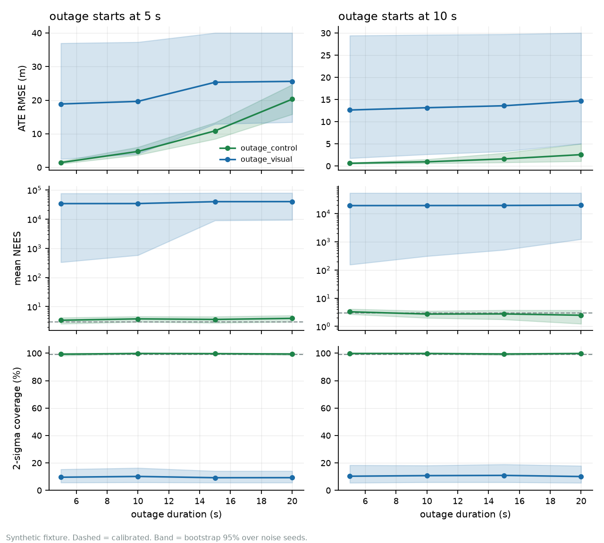

# Status and limits

- **Not field validated.** The benchmark is a synthetic fixture. Recorded IMU data
  ([EuRoC](euroc.md), [TUM VI](tumvi.md)) and one set of real camera frames
  ([a real front end](real_front_end.md)) are used with GNSS simulated from the ground truth. None of that
  data is vendored, and no number is a field measurement.
- **Visual aiding under GNSS denial is untrustworthy with the shipped single anchor**, and disabled by default.
  See [concepts](concepts.md#the-one-thing-this-cannot-do). The opt-in stochastic clone
  ([ADR-0017](adr/0017-stochastic-clone-for-the-visual-update.md)) is calibrated for independent visual errors.
  Against the measured errors of a real two-view front end it stays inside the gate only with the assumed
  noise inflated by four, in all six windows measured, which is a named opt-in setting
  ([ADR-0023](adr/0023-clone-against-a-measured-front-end.md), [ADR-0024](adr/0024-assumed-noise-for-the-opt-in-clone.md)).
- **FDIR detects implausible updates and can name only some causes.** The chi-square gate in `fdir/` isolates a
  channel and says how long it was out ([ADR-0005](adr/0005-chi-square-fdir-gating.md)). A multipath call exists as
  a function ([ADR-0022](adr/0022-multipath-signature.md)). Spoofing and degradation are called correctly
  in most injected runs, weak faults are missed and the false-alarm rate is not zero; the rates are on the
  [fault classification](fault_classification.md) page
  ([ADR-0021](adr/0021-fault-classification-from-innovations.md)).
- **A slow-ramp spoof is followed.** With an IMU and GNSS alone the filter follows a ramp of any rate tested
  ([ADR-0019](adr/0019-slow-ramp-spoofing.md)). A simulated visual source catches a fast ramp when its errors are
  independent ([ADR-0020](adr/0020-second-source-against-a-ramp.md)).
- **The calibrated-covariance failure is mitigated, not fixed.** The ADR-0005
  gate assumed a calibrated innovation covariance the filter does not have once
  position covariance has collapsed, and in `outage_visual` that cost accuracy. That was blocker B5, closed by
  [ADR-0006](adr/0006-nis-window-monitor.md): a per-channel NIS window plus
  adaptive GNSS covariance inflation, which re-gates a returning fix once
  under an inflated covariance. The ATE and the number of rejected fixes both fell, with the false-alarm
  rate unchanged (R2 in [CONSTRAINTS.md](https://github.com/Telschow/contested-nav/blob/main/CONSTRAINTS.md)
  records the figures at the time). B1 is still open, see below.
- **The filter is still overconfident under visual aiding.** Over the GNSS outage window, `outage_visual`
  has a mean NEES of <!-- metric:outage_visual_window_nees -->2777.2<!-- /metric --> against a nominal 3 and a
  2σ coverage of <!-- metric:outage_visual_window_coverage_percent -->4.3<!-- /metric -->% where the SRS requires
  95% (AC-04) and the roadmap gate for turning vision on is above 90%. The full-run values are in the table in
  the [README](https://github.com/Telschow/contested-nav/blob/main/README.md). It converges and
  is confidently wrong. This is blocker B1, and it is a pose-graph problem that
  no threshold in the FDIR subsystem will move. In the seed and outage sweeps it held in every run (measured once on one machine, not checked by CI, at e94c107). The
  scene sweep was last measured on the old fixed start (see the provenance note below).

- **ADR-0008 frozen-anchor cross-check: implemented but unreachable under the
  current state-transition logic; the security gap remains documented as open.**
- **The published numbers are single draws.** The shipped tables are the seed-0 benchmark with one start draw
  ([ADR-0027](adr/0027-how-the-synthetic-runs-are-initialised.md)), which is the committed artefact, and a single run
  is descriptive. Over 10 seeds the `outage_control` verdict was underconfident in 5, mixed (bulk overconfident, tail
  underconfident) in 2, mixed (bulk overconfident, tail calibrated) in 2 and overconfident in 1, and the mean NEES of
  the anchor rows spanned one to two orders of magnitude (measured once on one machine, not checked by CI, at e94c107). Treat the magnitudes of the anchor rows as
  order-of-magnitude, and their verdict, not a control's, as the claim.
- **Provenance of the sweep results.** The seed and outage sweeps were re-run on the start drawn from the declared
  prior at e94c107, once on one machine (not checked by CI). The scene sweep was last measured at 2026-10-09, before
  the attitude reset fix (R6 in
  [CONSTRAINTS.md](https://github.com/Telschow/contested-nav/blob/main/CONSTRAINTS.md)) and on the old fixed start,
  and was not re-run. None of their outputs is committed, so this page quotes counts, not figures, except where it
  labels a one-off figure. `navkit sweep seeds`, `navkit sweep scenes` and `navkit sweep outages` regenerate them.
- **Scene generalisation is demonstrated, external validity is not.** The
  8-scene sweep (measured on the old fixed start, not re-run) varied trajectory geometry over a wide path-length
  range and all seven verdicts held, so the failure above is not a property of one path. What is
  *not* shown: any real capture, any measured sensor characteristic, or any scene
  outside an analytic trajectory generator. Eight synthetic scenes bound the
  claim "the anchor model is structurally wrong under visual aiding"; they do not
  bound its behaviour on real imagery. Scenario duration remains fixed at 30 s.
- **The anchor model's overconfidence does not depend on the outage window, and neither does its lack of an
  accuracy gain.** The outage sweep (`navkit sweep outages`, 8 windows, 5 seeds each, one synthetic path, each seed
  with its own start draw) gave `outage_visual` a 2-sigma coverage far below its expected value and a mean NEES far
  above it in **all 40 runs**, including 5 s outages (measured once on one machine, not checked by CI, at e94c107). In all 8 windows, with the seeds averaged, its ATE
  was larger than the control's. An earlier version of this page said vision beat the control when the outage started
  early; that was measured on the old fixed start and no longer holds. So "vision improves ATE" is not a result of
  this fixture with a start error drawn from the prior.

  
- **Not flight-ready.** No sensor driver, no live front end, no real-time loop,
  no failure-mode handling beyond a measurement gate.
- **Recorded-data checks skip without the data.** The trajectory reader's orientation is checked against the
  recorded gyroscope on every fetched sequence, and always on a synthetic one. The claim of reproducing a
  published TUM VI ATE was retired (R5 in `CONSTRAINTS.md`).
